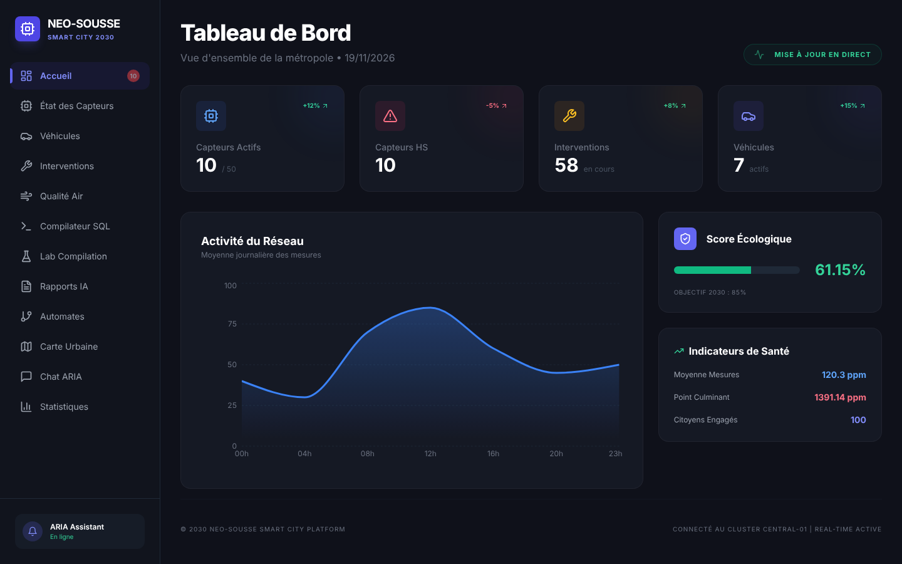

# 🏙️ SmartCity — Neo-Sousse 2030

Plateforme Smart City : compilateur langage naturel → SQL, automates finis, assistant IA et tableau de bord React.



## 🚀 Lancer le projet

```bash
cd backend
cp .env.example .env
pip install -r requirements.txt
python bdd/generate_data.py
python app.py
```

```bash
cd frontend
npm install
npm run dev
```

Ouvrir http://localhost:3000
