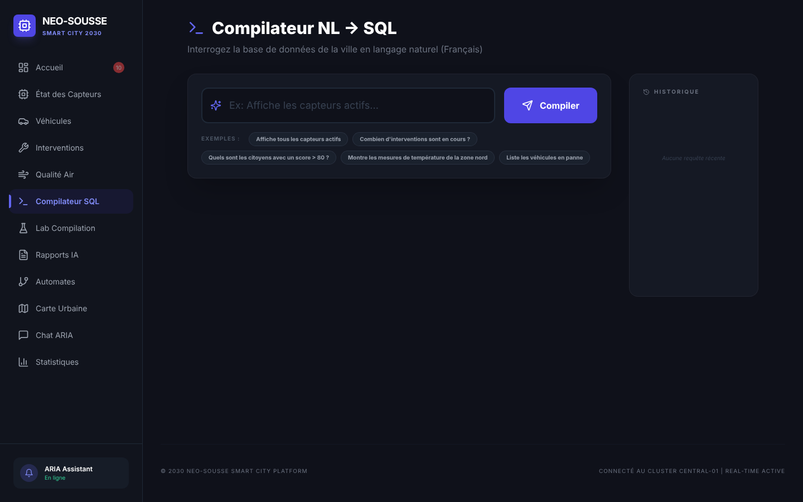
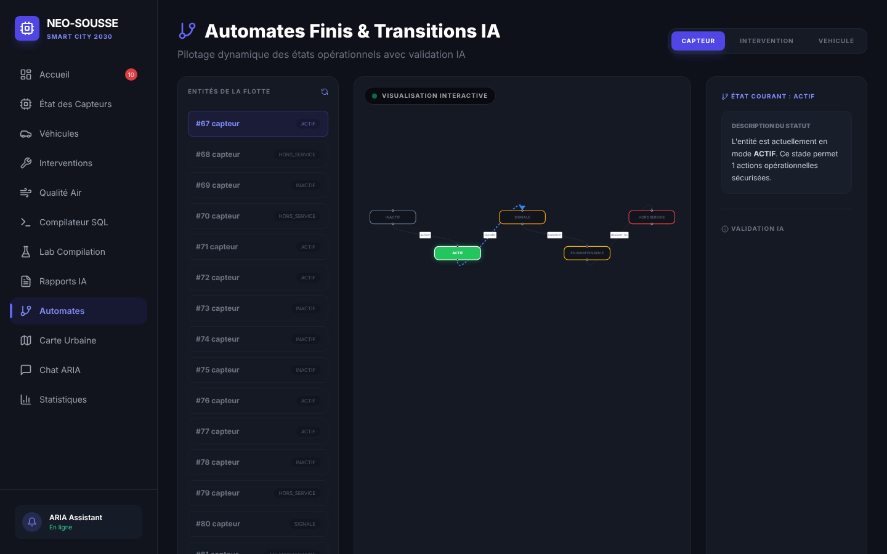
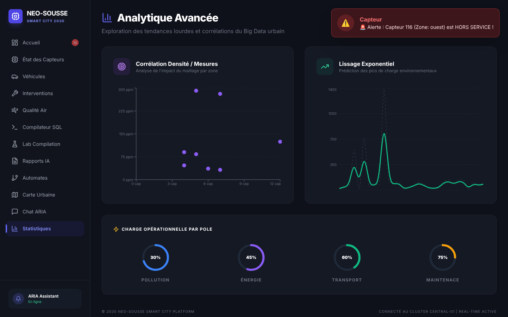

# 🏙️ Smart City Neo-Sousse 2030

**Projet de Théorie des Langages et Compilation — Section IA 2**

Plateforme de gestion urbaine intelligente pour la ville de Sousse. Elle réunit :
- un **compilateur langage naturel → SQL** écrit à la main (lexer, parser, analyse sémantique, génération de code) ;
- des **automates finis** qui pilotent le cycle de vie des capteurs, des interventions et des véhicules ;
- un **assistant IA** (OpenRouter) pour les rapports, les suggestions et le chat ;
- un **tableau de bord React** mis à jour en temps réel par WebSockets.


---

## ✨ Fonctionnalités

| Module | Description |
|---|---|
| 🏠 **Tableau de bord** | KPIs en temps réel (capteurs actifs/HS, interventions, véhicules, score écologique) |
| 💻 **Compilateur NL → SQL** | *« Affiche les 5 zones les plus polluées »* → requête SQL exécutée sur PostgreSQL |
| 🧪 **Lab Compilation** | visualisation des étapes : tokens, AST, analyse sémantique, SQL |
| 🔀 **Automates** | machines à états des capteurs, interventions et véhicules, avec validation IA des transitions |
| 📊 **Statistiques et Qualité de l'air** | graphiques Recharts sur les mesures |
| 🗺️ **Carte urbaine** | carte Leaflet des zones de la ville |
| 🤖 **Rapports IA et Chat ARIA** | rapports journaliers, suggestions d'actions et assistant conversationnel |

| Compilateur | Automates | Statistiques |
|---|---|---|
|  |  |  |

## 🧠 Le compilateur NL → SQL

```
« Combien de capteurs sont hors service ? »
        │
   lexer.py       → tokens (mots-clés, entités, opérateurs, nombres…)
        │
   nl_parser.py   → arbre syntaxique (QueryNode)
        │
   semantic.py    → vérification des tables, colonnes et types
        │
   codegen.py     → SELECT COUNT(*) FROM capteurs WHERE statut = 'HORS_SERVICE';
        │
   db_executor.py → exécution sur PostgreSQL
```

## 📁 Structure du projet

```
compilation/
├── backend/             # API Flask + WebSockets (port 5000)
│   ├── app.py
│   └── ia_module.py     # IA générative (OpenRouter)
├── frontend/            # Tableau de bord React + Vite + Tailwind (port 3000)
│   └── src/components/
├── compilateur/         # Compilateur NL → SQL
│   ├── lexer.py
│   ├── nl_parser.py
│   ├── semantic.py
│   ├── codegen.py
│   ├── compiler.py      # orchestre les 4 phases
│   └── db_executor.py   # exécute le SQL généré
├── automates/           # Automates finis (bibliothèque transitions)
│   ├── automate_capteur.py
│   ├── automate_intervention.py
│   ├── automate_vehicule.py
│   ├── automates_db.py      # automates connectés à la base
│   └── automates_visual.py  # génère les diagrammes SVG et HTML
├── bdd/                 # Base de données
│   ├── db_config.py         # connexion (lit le fichier .env)
│   ├── generate_data.py     # crée les tables et génère les données
│   └── timescale_setup.py   # optionnel : TimescaleDB et vues temporelles
├── ia/                  # Scripts IA autonomes
│   ├── ia_chat.py               # chat en console (OpenRouter)
│   ├── generer_rapports_ollama.py
│   └── module_ia_ollama.py      # version locale avec Ollama
├── tests/
│   ├── test_compiler.py     # tests du compilateur
│   ├── scenarios.py         # 10 scénarios de bout en bout
│   └── test_api.py          # test des endpoints de l'API
├── docs/screenshots/
├── requirements.txt
└── .env.example
```

---

## 🚀 Installation

### Prérequis
- **Python 3.10+**
- **Node.js 18+**
- **PostgreSQL**, sur le port `5434` par défaut (modifiable dans `.env`)

### 1. Cloner le projet
```bash
git clone https://github.com/SalmaZaafrani/compilation.git
cd compilation
```

### 2. Configurer le fichier `.env`
```bash
# Windows
copy .env.example .env
# macOS / Linux
cp .env.example .env
```
Renseignez le mot de passe PostgreSQL et la clé OpenRouter dans `.env`. Une clé gratuite s'obtient sur [openrouter.ai/keys](https://openrouter.ai/keys) ; utilisez alors un modèle dont l'identifiant se termine par `:free`.

### 3. Créer la base et générer les données
Créez une base `smartcity` (dans pgAdmin ou avec `psql -U postgres -p 5434 -c "CREATE DATABASE smartcity;"`), puis :
```bash
python -m venv venv
venv\Scripts\activate          # macOS / Linux : source venv/bin/activate
pip install -r requirements.txt
python bdd/generate_data.py
```

### 4. Lancer le backend (terminal 1)
```bash
cd backend
python app.py
```
L'API démarre sur http://localhost:5000.

### 5. Lancer le frontend (terminal 2)
```bash
cd frontend
npm install
npm run dev
```
Ouvrez **http://localhost:3000** 🎉

---

## 📡 API

| Méthode | Endpoint | Description |
|---|---|---|
| GET | `/api/dashboard` | KPIs |
| GET | `/api/capteurs` | liste des capteurs |
| GET | `/api/interventions` | liste des interventions |
| GET | `/api/mesures` | mesures récentes |
| GET | `/api/citoyens` | liste des citoyens |
| GET | `/api/vehicules` | liste des véhicules |
| GET | `/api/rapport` | rapport journalier IA |
| GET | `/api/suggestions` | suggestions d'actions |
| POST | `/api/compiler` | compile et exécute une requête en langage naturel |
| POST | `/api/chat` | chat avec l'assistant ARIA |

## 🔬 Tests et scripts utiles

```bash
python tests/scenarios.py            # 10 scénarios de bout en bout
python tests/test_compiler.py        # tests du compilateur
python tests/test_api.py             # backend lancé au préalable
python automates/automates_visual.py # génère les diagrammes des automates
python bdd/timescale_setup.py        # optionnel : TimescaleDB
```

## 👩‍💻 Auteure

**Salma Zaafrani** — [@SalmaZaafrani](https://github.com/SalmaZaafrani)
